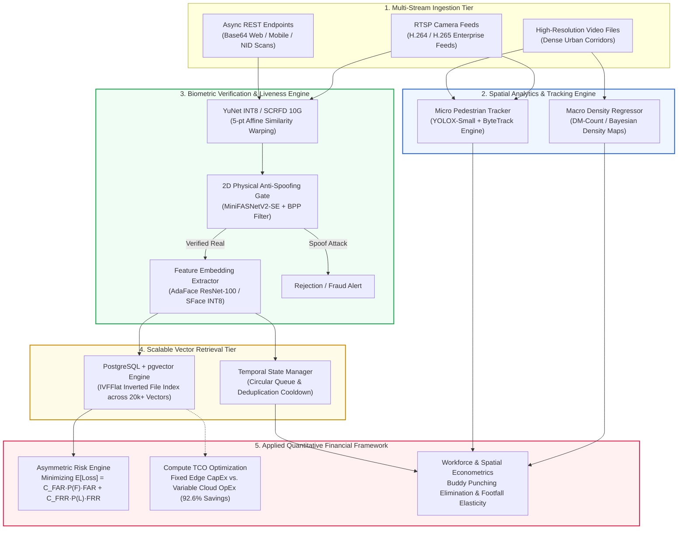

# Physical Intelligence & Quantitative Financial Architecture Portfolio

> **Engineering Domain:** Video Analytics, Edge Biometrics, Scalable Vector Systems & MLOps  
> **Academic Foundation:** B.Sc. in Economics & Finance, BRAC University  
> **Author Profile:** Machine Learning & Data Engineer  
> **Repository Nature:** 100% Pure System Design RFCs, Architectural Specifications & Mathematical Models (Zero Proprietary Code)

---

## Executive Overview

Modern enterprise video analytics is more than computer vision—it is an **infrastructure and capital investment** that directly impacts enterprise risk, operating margins, and asset productivity. 

This repository presents an executive-grade **System Architecture Portfolio** synthesizing four production-grade computer vision systems into a unified platform. It pairs low-latency deep learning inference and high-dimensional vector retrieval with **Microeconomic Decision Theory, Asymmetric Risk Formulations, and Capital Budgeting (CapEx vs. OpEx)**.



---

## Architectural Pillar Index

The portfolio is structured into five comprehensive technical design documents:

| Pillar | Focus Area | Core Technologies | Economic / Financial Domain | Documentation Link |
| :--- | :--- | :--- | :--- | :--- |
| **Flagship 1** | **FinTech e-KYC & Anti-Spoofing API** | FastAPI, SCRFD 10G, AdaFace (ResNet-100), MiniFASNetV2-SE, Pillow-HEIF, Rawpy | **Asymmetric Loss Modeling**: $Cost(\text{FAR}) \gg Cost(\text{FRR})$, AML fine mitigation, SaaS displacement ROI | [**Read RFC 01**](docs/01_flagship_ekyc_face_verification.md) |
| **Flagship 2** | **Distributed Edge RTSP Face Recognition** | Multi-threaded RTSP, YuNet INT8, SFace INT8, PostgreSQL, `pgvector` (IVFFlat) | **Capital Budgeting (TCO)**: Edge CapEx vs Cloud OpEx (92.6% cost reduction), Principal-Agent labor theory | [**Read RFC 02**](docs/02_flagship_edge_rtsp_attendance.md) |
| **Pillar 3** | **Precision Pedestrian Tracking** | YOLOX-Small (35MB), ByteTrack, ONNX Runtime CUDA, Sub-Decimal Calibration | **Retail Conversion Elasticity**: Footfall-to-revenue models ($\varepsilon_{R, F}$), Edge hardware CapEx optimization | [**Read RFC 03**](docs/03_precision_people_tracking.md) |
| **Pillar 4** | **Macroscopic Crowd Density Mapping** | DM-Count (Optimal Transport), Bayesian point loss, CSRNet, Spatial integration | **Spatial Asset Economics**: Commercial floor-space capacity yield, Actuarial crowd surge disaster insurance | [**Read RFC 04**](docs/04_macro_crowd_density_analytics.md) |
| **Pillar 5** | **Quantitative Financial Framework** | Applied Econometrics, Microeconomic Decision Theory, NPV Modeling | **Mathematical Synthesis**: Formal derivations of loss matrices, TCO schedules, and labor moral hazard | [**Read Framework 05**](docs/05_economic_tradeoff_framework.md) |

---

## Key Engineering Innovations & Highlights

### 1. FinTech e-KYC: Solving Physical 2D Anti-Spoofing Vulnerabilities
* **Information Density ($BPP$) Filter:** Implemented a pre-inference perimeter gate requiring $\ge 1.0\text{ Bits Per Pixel}$, instantly filtering out compressed social media portrait replays before GPU invocation.
* **Apple Deep Fusion vs. RAW Bayer Analysis:** Diagnosed computational noise-reduction bypasses where mobile JPEG conversion blurs away microscopic moiré screen fringes. Built raw sensor (`.DNG`) pipelines to inspect pristine high-frequency sensor noise.
* **Quality-Adaptive Matching (AdaFace):** Adaptively modulates cosine margins based on feature norms, solving false rejections caused by faded, laminated National ID card scans.
* **Asynchronous Concurrency:** Designed an `async def` FastAPI architecture offloading blocking neural execution to thread pools, achieving a **58x throughput speedup (0.077s vs 4.50s)** under concurrent multi-client load.

### 2. Enterprise Edge RTSP: Scalable Vector Search at Sub-5ms
* **PostgreSQL + `pgvector` (IVFFlat):** Partitioned 20,000+ enrolled identity embeddings into 100 Voronoi clusters, reducing candidate vector checks from 20,000 to ~2,000 and yielding sub-5ms nearest-neighbor queries.
* **Thread-per-Camera Ingestion:** Decoupled socket capture from neural execution using atomic circular queues (`maxlen=1`), eliminating the RTSP buffer accumulation lag common in standard loops.
* **Temporal Cooldown Engine:** Enforced sliding-window deduplication state machines to prevent repeated check-in logging during continuous employee transit.

### 3. Pedestrian Tracking: The Sub-Decimal Mathematical Calibration
* **Transition Cliff Discovery:** Discovered a discrete tracking count jump over a tiny $0.001$ threshold interval on YOLOX-Small.
* **Sub-Decimal Interpolation:** Formulated linear interpolation to derive the exact matching threshold:
  $$\tau^* = 0.496 + \left(\frac{392 - 388}{399 - 388}\right) \times 0.001 \approx \mathbf{0.4964}$$
* **Flawless Parity:** Achieved a **0.00% error rate (392/392 unique people)** matching the heavy YOLOX-X baseline, while reducing memory footprint by **11.3x (35 MB vs 395 MB)** and accelerating pipeline speed by **1.87x**.

### 4. Crowd Density: Multi-Architecture Cross-Validation
* **Spatial Integral Formulation:** Modeled extreme crowd scenes (>1,000 people per frame) where bounding boxes fail as continuous 2D density surfaces: $\hat{N} = \iint_\Omega D(x, y) \, dx \, dy$.
* **Triangulated Verification:** Cross-validated DM-Count (QNRF: 1,872) against Bayesian point regression (1,758) and ShanghaiTech-A (2,196), establishing a reliable ensemble peak estimate of **1,942.57 ± 183.79**.

---

## Applied Economics & Quantitative Finance Interlock

Coming from an academic background in **Economics and Finance at BRAC University**, this portfolio addresses technical decisions through a quantitative financial lens:

```
┌─────────────────────────────────┬────────────────────────────────────────────────────────┐
│ Economic Concept                │ Engineering Application & Quantitative Value           │
├─────────────────────────────────┼────────────────────────────────────────────────────────┤
│ Asymmetric Loss Functions       │ Balances Cost(FAR) >> Cost(FRR) to minimize dollar     │
│                                 │ losses from digital onboarding AML & credit fraud.     │
├─────────────────────────────────┼────────────────────────────────────────────────────────┤
│ Total Cost of Ownership (TCO)   │ Quantifies 92.6% cost reduction ($107,000 saved over   │
│                                 │ 3 years) by deploying INT8 edge models over AWS GPU.   │
├─────────────────────────────────┼────────────────────────────────────────────────────────┤
│ Principal-Agent Moral Hazard    │ Eliminates "buddy punching" time-theft, recovering     │
│                                 │ $220k–$500k in unearned payroll margins per 1k staff.  │
├─────────────────────────────────┼────────────────────────────────────────────────────────┤
│ Footfall Conversion Elasticity  │ Unbiased estimation of retail conversion elasticity    │
│                                 │ (d ln Y / d ln F) enabled by 0.00% tracking accuracy.  │
└─────────────────────────────────┴────────────────────────────────────────────────────────┘
```

---

## Repository Structure & Diagram Assets

```
video_analytics_architecture_portfolio/
├── README.md                                  # Portfolio Master Guide (You are here)
├── docs/
│   ├── 01_flagship_ekyc_face_verification.md   # Flagship 1: eKYC, AdaFace, Anti-Spoofing & FinTech Fraud
│   ├── 02_flagship_edge_rtsp_attendance.md     # Flagship 2: Multi-stream RTSP, pgvector, Scalable Identity
│   ├── 03_precision_people_tracking.md        # Pillar 3: YOLOX, ByteTrack & Sub-Decimal Calibration
│   ├── 04_macro_crowd_density_analytics.md     # Pillar 4: Spatial Density Mapping & Crowd Dynamics
│   └── 05_economic_tradeoff_framework.md      # Pillar 5: Applied Quantitative Financial Framework
├── diagrams/                                  # Modular, publication-ready Mermaid diagrams
│   ├── unified_system_topology.mermaid
│   ├── ekyc_anti_spoof_pipeline.mermaid
│   ├── edge_rtsp_vector_search.mermaid
│   ├── tracker_calibration_curve.mermaid
│   └── crowd_density_pipeline.mermaid
└── .gitignore                                 # Clean gitignore excluding system/temporary files
```

---

## Compliance & Confidentiality Notice

This portfolio strictly contains **conceptual system architecture documentation, mathematical models, and design trade-off analyses**. 

* **Zero Proprietary Code:** Contains no proprietary source code, internal software firm scripts, or private repository files.
* **Zero Confidential Data:** Contains no client credentials, private database passwords, internal IP addresses, or proprietary customer data.
* **Public Domain Science:** All neural network architectures (InsightFace, AdaFace, MiniFASNet, YOLOX, ByteTrack, DM-Count, PostgreSQL) reference publicly available research literature and open-source models.
