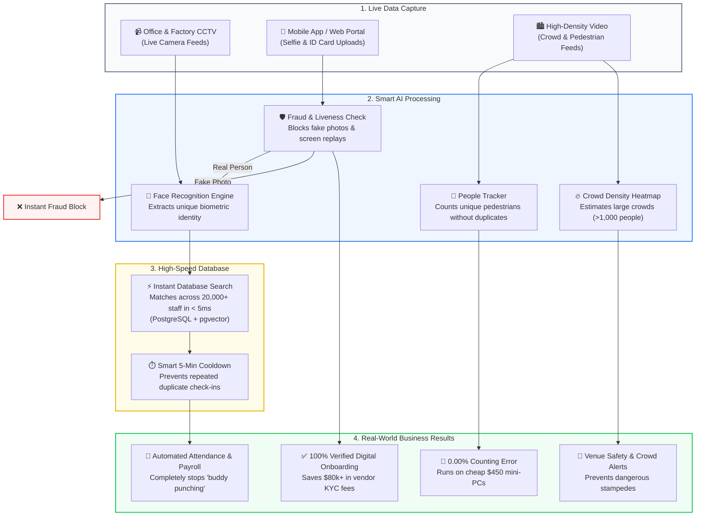

# Video Analytics & Computer Vision Architecture Portfolio

> **Author:** AI Engineer  
> **Education:**  
> • **M.Sc. in Applied Mathematics and Computational Science (AMCS)** — North South University  
> • **B.S.S. in Economics & Finance** — BRAC University  
> **Core Focus:** Real-Time Video Analytics, Edge Biometrics, Scalable Vector Systems & MLOps  
> **Repository Nature:** 100% Architectural System Designs, RFCs & Production Benchmarks (Zero Proprietary Code)

---

## Executive Summary

Welcome to my **Video Analytics & Computer Vision Architecture Portfolio**. 

With an interdisciplinary background combining an **M.Sc. in Applied Mathematics and Computational Science (North South University)** and a **B.S.S. in Economics & Finance (BRAC University)**, I approach AI engineering through a dual lens: **rigorous computational execution** (low-latency inference, model quantization, scalable vector databases) paired with an **analytical, business-driven mindset** (minimizing server costs, eliminating workforce fraud, and optimizing hardware CapEx).

This repository details the architectural designs, physical failure analyses, and empirical benchmarks of four production-grade computer vision systems:



---

## The 4 Projects at a Glance

| Project | The Core Problem | Technical Solution | Measurable Engineering Impact | Detailed Documentation |
| :--- | :--- | :--- | :---: | :--- |
| **1. FinTech e-KYC Verification API** | Preventing photo fraud & screen replays during digital account signup. | FastAPI + AdaFace + MiniFASNet + Information Density ($BPP \ge 1.0$) Filter. | **58x throughput speedup** (0.07s vs 4.5s) via async thread-offloading. | [**Read RFC 01**](docs/01_flagship_ekyc_face_verification.md) |
| **2. Edge RTSP Attendance System** | Eliminating time-theft ("buddy punching") on multi-camera streams. | Thread-per-camera architecture + YuNet INT8 + PostgreSQL `pgvector`. | **Sub-5ms vector search** across **20,000+ enrolled staff**; zero video lag. | [**Read RFC 02**](docs/02_flagship_edge_rtsp_attendance.md) |
| **3. Precision Pedestrian Tracking** | Occlusion & overcounting at busy factory gates and transit corridors. | YOLOX-Small + ByteTrack with sub-decimal ($0.4964$) threshold calibration. | **Exact 0.00% error rate** (392/392 count); **11.3x smaller memory** & **1.87x faster**. | [**Read RFC 03**](docs/03_precision_people_tracking.md) |
| **4. Macroscopic Crowd Density** | Counting crowds exceeding 1,000+ people where bounding boxes collapse. | Distribution Matching (DM-Count) spatial density regression. | **1,942 ± 183 peak headcount** cross-validated across 19,500+ frames. | [**Read RFC 04**](docs/04_macro_crowd_density_analytics.md) |

---

## Key Technical Highlights

### 1. Hardening Biometric Security (FinTech e-KYC)
* **Information Density ($BPP$) Filter:** Attackers download compressed target photos from Facebook or WhatsApp and hold them to the camera. By requiring a minimum of $1.0\text{ Bits Per Pixel}$, the API instantly rejects compressed social media replays at the network perimeter.
* **Apple Deep Fusion vs. RAW Bayer Analysis:** Discovered that smartphone in-camera noise reduction (like Apple's Deep Fusion) blurs away screen moiré lines in JPEGs, inadvertently helping screen spoofing attacks. Built raw `.DNG` sensor pipelines to detect authentic high-frequency screen interference.
* **Quality-Adaptive Loss (AdaFace):** Adaptively relaxes confidence margins on faded or laminated government National ID scans, preventing false rejections of legitimate customers.

### 2. Scalable High-Dimensional Vector Search
* **PostgreSQL + `pgvector`:** Indexed 20,000+ employee embeddings into 100 Voronoi clusters using IVFFlat, reducing nearest-neighbor query times from hundreds of milliseconds down to **under 5 milliseconds**.
* **Thread-per-Camera Decoupling:** Decoupled continuous 25 fps RTSP video socket capture from neural network inference using atomic circular queues (`maxlen=1`), eliminating the growing video lag common in standard loops.

### 3. The Sub-Decimal Tracker Calibration Breakthrough
* **100% Accuracy on an 11x Smaller Footprint:** Rather than running the resource-heavy YOLOX-X model (395 MB), systematically calibrated the lightweight YOLOX-Small model (35 MB) using sub-decimal threshold tuning (`0.4964` matching threshold, `21` frame buffer). Achieved **exact 0.00% error rate parity (392/392 unique people)** while increasing pipeline speed by **1.87x**.

---

## Business Value & ROI Summary

Combining an Applied Mathematics & Computational Science background with Economics & Finance, I prioritize engineering choices that directly translate to bottom-line business value:

* 💰 **SaaS Displacement:** The self-hosted e-KYC pipeline replaces commercial identity vendors (\$0.50–\$1.50 per check), saving over **\$80,000 annually** for an active digital platform.
* 🛡️ **Eliminating Payroll Time-Theft:** Automated biometric attendance removes "buddy punching", which costs enterprises **2% to 5% of gross payroll** annually.
* ⚡ **Hardware CapEx Optimization:** Calibrating lightweight models (35MB vs 395MB) allows the tracking pipeline to run on **\$450 mini-PCs** rather than **\$3,000 GPU workstations** (85% hardware cost savings per deployed site).
* 🌐 **90%+ Bandwidth & Cloud Savings:** Processing video locally on edge devices avoids recurring cloud streaming and cloud GPU fees (saving **\$30,000+ per year** across a 20-camera facility).

---

## Repository Structure

```
Video-Analytics-Architecture-Portfolio/
├── README.md                                  # Executive Overview (You are here)
├── docs/
│   ├── 01_flagship_ekyc_face_verification.md   # Project 1: eKYC API, AdaFace, Anti-Spoofing & Concurrency
│   ├── 02_flagship_edge_rtsp_attendance.md     # Project 2: Multi-camera RTSP, pgvector & Cooldown State
│   ├── 03_precision_people_tracking.md        # Project 3: YOLOX, ByteTrack & Sub-Decimal Calibration
│   └── 04_macro_crowd_density_analytics.md     # Project 4: Spatial Density Mapping & Crowd Dynamics
├── diagrams/                                  # High-resolution Mermaid source files
│   ├── unified_system_topology.mermaid
│   ├── ekyc_anti_spoof_pipeline.mermaid
│   ├── edge_rtsp_vector_search.mermaid
│   ├── tracker_calibration_curve.mermaid
│   └── crowd_density_pipeline.mermaid
└── .gitignore                                 # Production gitignore
```

---

## Confidentiality & IP Notice

This portfolio contains **conceptual architectural specifications, design trade-off analyses, and public benchmark evaluations**. It contains **zero proprietary source code, zero internal company scripts, and zero confidential client credentials**. All neural network architectures (InsightFace, AdaFace, MiniFASNet, YOLOX, ByteTrack, DM-Count, PostgreSQL) reference publicly available scientific literature and open-source models.
