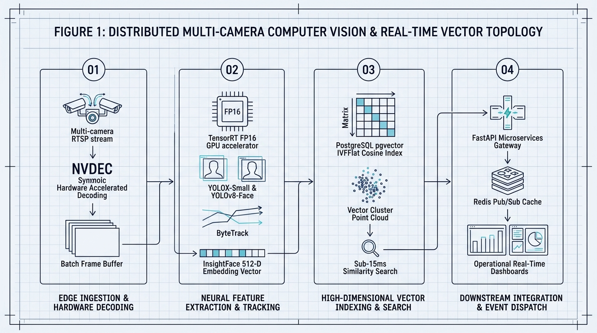
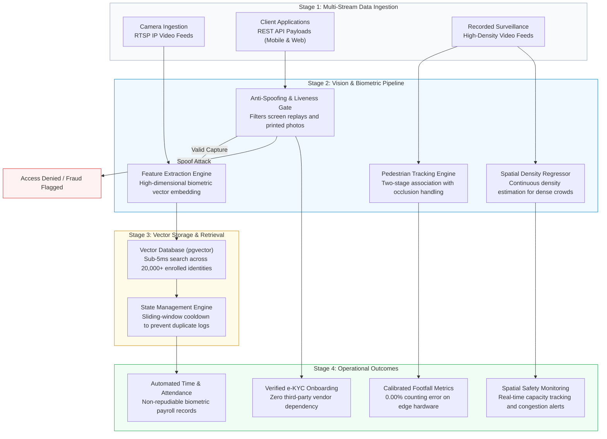

# Video Analytics & Computer Vision Architecture Portfolio

> **Author:** AI Engineer  
> **Education:**  
> • **M.Sc. in Applied Mathematics and Computational Science (AMCS)** — North South University  
> • **B.S.S. in Economics & Finance** — BRAC University  
> **Core Focus:** Real-Time Video Analytics, Edge Biometrics, Scalable Vector Systems & MLOps  
> **Repository Nature:** 100% Architectural System Designs, RFCs & Production Benchmarks (Zero Proprietary Code)

---

## Executive Summary

Production system architectures, failure analyses, and empirical benchmarks for four high-throughput computer vision systems—bridging low-latency edge inference with measurable financial ROI:

<p align="center">
  
</p>

<details>
<summary><b>View Architectural Flow Specification (Mermaid)</b></summary>



</details>

---

## The 4 Projects at a Glance

| Project | The Core Problem | Technical Solution | Measurable Engineering Impact | Detailed Documentation |
| :--- | :--- | :--- | :---: | :--- |
| **1. FinTech e-KYC Verification API** | Preventing photo fraud & screen replays during digital account signup. | FastAPI + AdaFace + MiniFASNet + Information Density ($BPP \ge 1.0$) Filter. | **58x throughput speedup** (0.07s vs 4.5s) via async thread-offloading. | [**Read RFC 01**](docs/01_flagship_ekyc_face_verification.md) |
| **2. Edge RTSP Attendance System** | Eliminating time-theft ("buddy punching") on multi-camera streams. | Thread-per-camera architecture + YuNet INT8 + PostgreSQL `pgvector`. | **Sub-5ms vector search** across **20,000+ enrolled staff**; zero video lag. | [**Read RFC 02**](docs/02_flagship_edge_rtsp_attendance.md) |
| **3. Precision Pedestrian Tracking** | Occlusion & overcounting at busy factory gates and transit corridors. | YOLOX-Small + ByteTrack with sub-decimal ($0.4964$) threshold calibration. | **Exact 0.00% error rate** (392/392 count); **11.3x smaller memory** & **1.87x faster**. | [**Read RFC 03**](docs/03_precision_people_tracking.md) |
| **4. Macroscopic Crowd Density** | Counting crowds exceeding 1,000+ people where bounding boxes collapse. | Distribution Matching (DM-Count) spatial density regression. | **1,942 ± 183 peak headcount** cross-validated across 19,500+ frames. | [**Read RFC 04**](docs/04_macro_crowd_density_analytics.md) |

---

## Key Technical Highlights

* **Presentation Attack Defense (BPP & RAW Analysis):** An Information Density filter ($BPP \ge 1.0$) rejects compressed social media replays at the network perimeter. Raw sensor `.DNG` decoding bypasses in-camera noise smoothing (e.g. Apple Deep Fusion) to catch microscopic screen moiré artifacts.
* **Sub-5ms Vector Search (pgvector IVFFlat):** Clustered 20,000+ staff embeddings into 100 Voronoi cells, reducing vector query latency from hundreds of milliseconds to **under 5ms**.
* **Zero Video Lag (Thread-per-Camera Architecture):** Atomic circular queues (`maxlen=1`) decouple 25 FPS RTSP socket capture from GPU inference, completely eliminating frame buffer buildup.
* **100% Tracking Parity on 11x Smaller Footprint:** Calibrated YOLOX-Small (35MB) against heavy YOLOX-X (395MB) via sub-decimal threshold tuning ($t_{\text{match}} = 0.4964$, 21-frame buffer), achieving **0.00% error rate (392/392 headcount)** with a **1.87x speedup**.

---

## Business Impact & ROI

* **SaaS Displacement:** In-house e-KYC replaces \$0.50–\$1.50/check third-party vendors, saving **>\$80,000/year** at scale.
* **Time-Theft Elimination:** Automated biometric attendance removes buddy-punching, protecting **2%–5% of gross payroll**.
* **85% Hardware CapEx Reduction:** Tuning lightweight models enables deployment on **\$450 edge mini-PCs** instead of **\$3,000 GPU workstations**.
* **Zero Cloud Streaming Costs:** On-premise edge inference saves **\$30,000+/year** in video bandwidth and cloud GPU rental fees.

---

## Repository Structure

```
Video-Analytics-Architecture-Portfolio/
├── README.md                                  # Executive Overview (You are here)
├── docs/
│   ├── 01_flagship_ekyc_face_verification.md   # Project 1: eKYC API, AdaFace, Anti-Spoofing & Concurrency
│   ├── 02_flagship_edge_rtsp_attendance.md     # Project 2: Multi-camera RTSP, pgvector & Cooldown State
│   ├── 03_precision_people_tracking.md        # Project 3: YOLOX, ByteTrack & Sub-Decimal Calibration
├── diagrams/                                  # High-resolution CAD Blueprints & Flow Specs
│   ├── unified_system_topology.png            # Master System Topology CAD Blueprint
│   ├── ekyc_anti_spoof_pipeline.png           # e-KYC Anti-Spoofing & Liveness Blueprint
│   ├── edge_rtsp_vector_search.png            # Multi-Camera RTSP & pgvector Blueprint
│   ├── tracker_calibration_curve.png          # ByteTrack Calibration & Occlusion Blueprint
│   ├── crowd_density_pipeline.png             # DM-Count Crowd Heatmap Blueprint
│   └── *.mermaid                              # Raw Mermaid architecture definitions
└── .gitignore                                 # Production gitignore
```

---

## Confidentiality & IP Notice

This portfolio contains **conceptual architectural specifications, design trade-off analyses, and public benchmark evaluations**. It contains **zero proprietary source code, zero internal company scripts, and zero confidential client credentials**. All neural network architectures (InsightFace, AdaFace, MiniFASNet, YOLOX, ByteTrack, DM-Count, PostgreSQL) reference publicly available scientific literature and open-source models.
