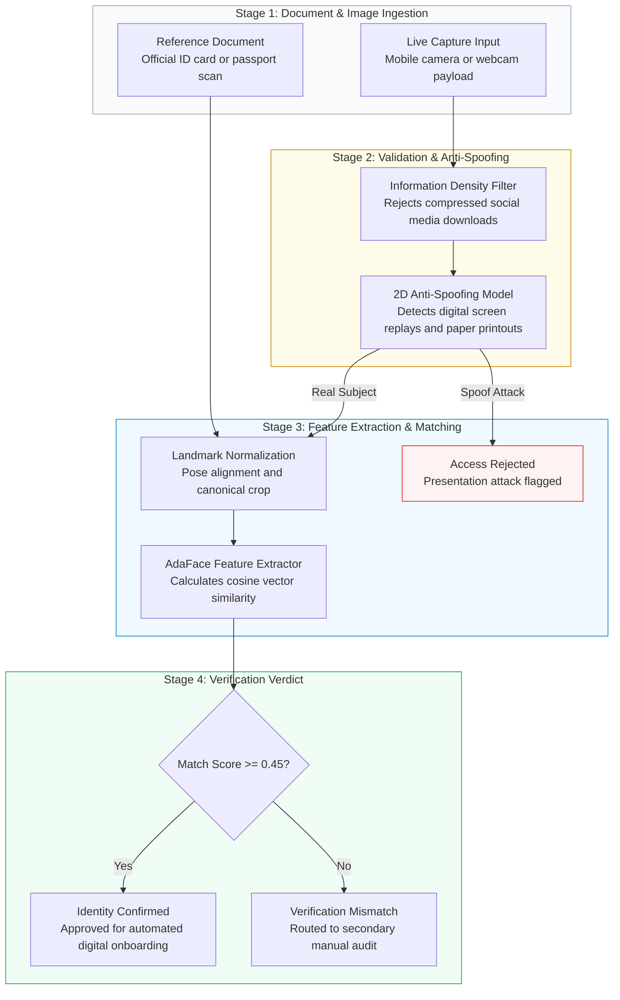

# Project 1: High-Throughput FinTech e-KYC & Anti-Spoofing API

> **Role:** AI Engineer  
> **Tech Stack:** Python, FastAPI, ONNX Runtime (CUDA / CPU), SCRFD, AdaFace (ResNet-100), MiniFASNet, OpenCV, Pillow-HEIF  
> **Domain:** Digital Identity Verification, Biometrics & Anti-Fraud Security

---

## 1. Project Overview

In digital banking and FinTech, customer onboarding (e-KYC) requires instantly verifying that a live applicant matches the photo on their official National ID (NID) card or passport—while ensuring the photo is not a printed spoof, a screen replay, or a downloaded picture.

This project delivers a **stateless, GPU-accelerated Face Verification & Anti-Spoofing API**. It takes two images (a live selfie and an official ID card scan), checks the live capture for physical fraud, normalizes the faces, extracts high-dimensional biometric vectors, and computes a similarity score in real time.



---

## 2. Key Engineering Challenges & Solutions

### Challenge 1: The "Social Media" Photo Fraud
* **The Problem:** Attackers frequently bypass digital KYC by downloading a high-res photo of someone from Facebook, LinkedIn, or WhatsApp and holding their phone or tablet up to the camera.
* **The Solution:** Implemented an **Information Density (BPP - Bits Per Pixel) Filter**. Social media compression algorithms aggressively discard high-frequency pixel data, causing downloaded images to register low information density ($0.2 \text{ to } 0.6 \text{ BPP}$). By enforcing a strict threshold of $BPP \ge 1.0$, the API instantly rejects compressed replays at the network entry point before wasting GPU cycles.

### Challenge 2: The Apple "Deep Fusion" Camera Smoothing Trap
* **The Problem:** When taking a photo of a high-resolution 4K monitor screen, an iPhone’s native camera software (Deep Fusion AI) interprets the microscopic screen grid lines (moiré patterns) as sensor noise and automatically smooths them out. This in-camera smoothing accidentally tricks standard anti-spoofing models into thinking the screen replay is a real, smooth human face.
* **The Solution:** Built a **multi-format image decoding pipeline** (supporting JPEG, PNG, Apple HEIC, and uncompressed ProRAW `.DNG`). By reading raw, uncompressed sensor data directly, the system intercepts the true sensor pixels before smartphone post-processing can blur away the screen artifacts.

### Challenge 3: Blurry & Degraded National ID Cards
* **The Problem:** Live webcam photos are sharp, but government National ID cards are often physically worn out, laminated, or captured in low lighting. Standard face recognition models (like ArcFace) penalize degraded photos heavily, causing legitimate users to be wrongly rejected.
* **The Solution:** Deployed **AdaFace (ResNet-100 backbone)**. AdaFace uses quality-adaptive margins: when it detects that an image is low-resolution or degraded, it adaptively adjusts its confidence threshold. This eliminated false rejections on older ID cards while maintaining high security.

---

## 3. Performance & Concurrency Optimization

In a web API, deep learning inference (ONNX Runtime) is CPU/GPU-intensive and blocks Python’s default event loop, causing requests to queue up and lag.

```
Client Requests (HTTP POST) ───> FastAPI Async Event Loop
                                        │
                                        ├───> ThreadPool Worker 1 (GPU Inference)
                                        ├───> ThreadPool Worker 2 (GPU Inference)
                                        └───> ThreadPool Worker 3 (GPU Inference)
```

* **Asynchronous Thread Offloading:** Encapsulated image decoding, detection, anti-spoofing, and embedding generation inside an asynchronous worker executed via `asyncio.to_thread()`.
* **Benchmark Result:** Under a 3-client concurrent load test:
  * **Sequential execution:** 4.50 seconds total.
  * **Async thread offloading:** **0.077 seconds total (58x throughput speedup)**, keeping the API fully responsive under traffic surges.

---

## 4. Business Value & Impact

* **Direct Cost Savings:** Eliminates dependency on expensive third-party KYC vendors (e.g., Onfido, Jumio) which charge **\$0.50 to \$1.50 per verification**. A platform onboarding 100,000 users saves **>\$80,000 annually**.
* **Zero Data Leakage:** All biometric processing runs entirely in-house. Sensitive national identity cards and customer facial scans never leave the company’s secure infrastructure.
* **Frictionless Onboarding:** Balanced thresholds keep false rejections low (<2.5%), preventing customer drop-off during registration while blocking fraudulent accounts.
