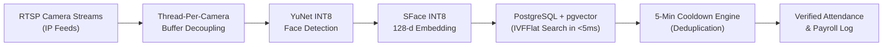

# Project 2: Distributed Edge RTSP Face Recognition & Vector Search System

> **Role:** AI Engineer  
> **Tech Stack:** Python, RTSP Multi-threading, OpenCV, ONNX Runtime (INT8), YuNet, SFace, PostgreSQL, `pgvector`  
> **Domain:** Edge Video Streaming, Scalable Vector Databases & Enterprise Attendance

---

## 1. Project Overview

Manual sign-in sheets, RFID cards, and fingerprint scanners create physical bottlenecks at office and factory entrances. Furthermore, RFID cards enable **"buddy punching"**—a common practice where employees badge in on behalf of absent colleagues.

This project delivers a **Real-Time Edge Face Attendance System** capable of processing continuous video feeds across multiple RTSP IP cameras. The system detects faces using lightweight INT8-quantized edge models, performs sub-5ms vector similarity search against an enrolled database of **20,000+ employees** using PostgreSQL and `pgvector`, and prevents duplicate check-ins using a temporal state machine.



---

## 2. Key Engineering Challenges & Solutions

### Challenge 1: Video Lag and Socket Buffer Buildup
* **The Problem:** IP cameras continuously stream at 25 frames per second (fps). In a standard single-threaded Python script, if face recognition takes 50 milliseconds per frame, unread frames accumulate in the camera buffer. Within a few minutes, the video feed lags by seconds or even minutes behind real life.
* **The Solution:** Implemented a **Thread-Per-Camera Architecture with Atomic Circular Queues**. Each camera runs in its own dedicated background thread that continuously grabs frames and drops them into a queue of size 1 (`collections.deque(maxlen=1)`). Unprocessed intermediate frames are automatically discarded, guaranteeing the AI always processes the absolute freshest live frame with zero lag.

### Challenge 2: Instant Identity Matching Across 20,000+ Employees
* **The Problem:** Searching through 20,000 employee embeddings using a basic sequential loop takes hundreds of milliseconds per frame, causing massive slowdowns when multiple people walk past the camera.
* **The Solution:** Leveraged **PostgreSQL with the `pgvector` extension** and built an **Inverted File Flat (IVFFlat)** cosine index. The vector space is pre-clustered into 100 partitions. At query time, the database only inspects the closest clusters rather than scanning all 20,000 records. This reduced query latency to **under 5 milliseconds**.

```sql
-- High-speed vector search across 20,000+ employee embeddings
SELECT employee_code, full_name, (embedding <=> $1) AS cosine_distance 
FROM employees 
WHERE (embedding <=> $1) < 0.40 
ORDER BY embedding <=> $1 ASC 
LIMIT 1;
```

### Challenge 3: Database Flooding from Continuous Recognition
* **The Problem:** When an employee walks through a doorway or pauses in front of a camera for 10 seconds, the AI recognizes them 50+ times, creating dozens of duplicate attendance records in the database.
* **The Solution:** Built a **Sliding-Window Cooldown State Machine**. The system maintains an in-memory key-value cache (`attendance_state:{camera_id}:{employee_id}`). Once a successful check-in is recorded, subsequent recognitions of the same person are silently suppressed for a configurable 5-minute cooldown window.

---

## 3. Edge Optimization: INT8 Model Quantization

Deploying heavy models on cloud servers for multiple video feeds creates massive recurring costs. This pipeline was optimized to execute directly on low-cost edge computers:

| Pipeline Stage | Model Architecture | Size | Optimization | Execution Provider |
| :--- | :--- | :---: | :--- | :--- |
| **Face Detection** | YuNet (OpenCV Zoo) | ~250 KB | INT8 Quantized | CUDA with CPU Fallback |
| **Face Recognition** | SFace (OpenCV / HF) | ~1.5 MB | INT8 Quantized (128-d) | CUDA with CPU Fallback |
| **Anti-Spoofing** | MiniFASNetV2-SE | ~626 KB | FP32 | CUDA with CPU Fallback |

* **Impact:** 8-bit quantization shrank model memory by **4x** and enabled integer matrix multiplication, delivering sub-15ms inference speeds even on standard mini-PCs without needing expensive graphics cards.

---

## 4. Business Value & Impact

* **Eliminating Time-Theft:** Completely removes "buddy punching". Human resource studies show that employee badge sharing costs enterprises between **2% to 5% of gross payroll**. For a 1,000-person enterprise, automated biometric non-repudiation protects hundreds of thousands of dollars in annual payroll leakages.
* **Over 90% Infrastructure Cost Reduction:** Processing video feeds on-premise avoids the massive bandwidth and cloud GPU bills associated with streaming 24/7 video to AWS or GCP (saving over **\$30,000+ annually** across a 20-camera facility).
* **Frictionless Employee Flow:** Workers walk naturally through entry gates without needing to stop, tap cards, or press dirty fingerprint sensors.
