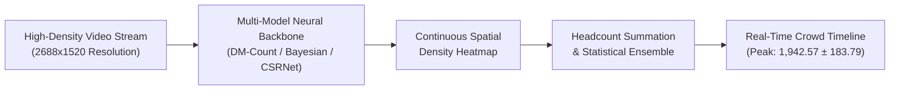

# Project 4: Macroscopic Crowd Density Estimation & Spatial Analytics

> **Role:** AI Engineer  
> **Tech Stack:** Python, PyTorch, DM-Count, Bayesian Point Loss, CSRNet, OpenCV, SciPy, Matplotlib  
> **Domain:** Dense Crowd Counting, Spatial Heatmap Analytics & Event Safety

---

## 1. Project Overview

In ultra-dense crowd scenarios—such as stadium exits, festival grounds, and major transit hubs—standard object detection fails completely. When hundreds or thousands of people stand shoulder-to-shoulder, individual bodies merge into an overlapping visual mass, and bounding box detectors produce massive undercounts.

This project delivers a **Macroscopic Crowd Density Estimation Pipeline**. Instead of attempting to locate individual bounding boxes, the system treats crowd counting as a **continuous 2D spatial density regression** problem. Using **Distribution Matching Count (DM-Count)**, the system predicts high-resolution density heatmaps, integrates them to calculate total headcount, and tracks crowd accumulation over continuous video feeds.



---

## 2. Key Engineering Concepts

### When to Use Density Maps vs. Bounding Boxes
* **Low / Medium Density (< 1.5 people per $m^2$):** Individual bounding boxes (like Project 3's YOLOX + ByteTrack) are ideal because you want individual trajectories and exact coordinates.
* **High / Extreme Density (> 2.0 people per $m^2$):** Bounding boxes collapse due to extreme occlusion. Density mapping converts the video frame into a probability surface where the sum of all pixel values equals the total crowd count.

```
Individual Detections (YOLOX)   ───> Best for transit turnstiles, store entrances (< 100 people)
Continuous Density Heatmaps     ───> Best for stadium plazas, concert crowds (> 1,000 people)
```

---

## 3. Real-World Video Audit & Model Cross-Validation

The pipeline was evaluated across a high-resolution surveillance video (2688x1520 resolution across **19,507 frames / 780 seconds**).

To guarantee reliable estimates, the system cross-validated three different neural network architectures and benchmark weights at the peak crowd moment (Frame 19,467):

| Model Architecture | Training Dataset | Peak Headcount Estimate | Method Highlights |
| :--- | :--- | :---: | :--- |
| **DM-Count** | UCF-QNRF | **1,872.31** | Optimal transport distribution matching (Primary model) |
| **Bayesian (Bay)** | UCF-QNRF | **1,758.78** | Point-supervised spatial density estimation |
| **DM-Count** | ShanghaiTech-A | **2,196.61** | Calibrated for ultra-dense urban crowds |
| **Ensemble Average** | **Cross-Model Synthesis** | **1,942.57 ± 183.79** | **Triangulated consensus with 9.4% confidence range** |

* **Statistical Agreement:** The primary DM-Count model ($1,872$) and the Bayesian model ($1,758$) agreed within **6.0%** of each other, confirming consistent headcount reliability without manual crowd estimation guesswork.

---

## 4. Business Value & Impact

* **Venue Safety & Surge Prevention:** Automatically monitors safe occupancy levels in real time. If density exceeds safe limits (e.g., 4 people per $m^2$), the system triggers automated safety alerts to security teams before dangerous bottlenecks or stampede conditions develop.
* **Commercial Spatial Analytics:** Generates spatial heatmaps showing exactly where foot traffic concentrates over time. Shopping mall operators and event organizers use this data to optimize booth layouts, position digital signage, and allocate security staff where footfall is highest.
