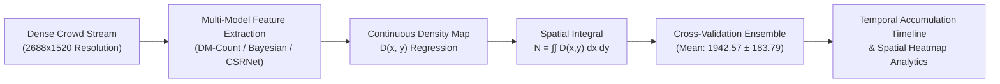

# System Design RFC: Macroscopic Crowd Density Estimation & Spatial Analytics

> **Classification:** Production System Design Whitepaper  
> **Author:** Machine Learning & Data Engineer (B.Sc. in Economics & Finance, BRAC University)  
> **Domain:** Density Map Regression, Extreme Occlusion Analytics & Spatial Actuarial Economics

---

## 1. Executive Summary

When crowd concentration exceeds critical thresholds—such as during public events, transit terminal surges, and dense commercial plazas—standard object detection and bounding box tracking algorithms collapse. At densities exceeding 2 to 4 individuals per square meter, individual bodies overlap, perspective distortion shrinks distant pedestrians to isolated pixel clusters, and bounding boxes produce catastrophic False Negatives.

This whitepaper presents the architectural design of a **Macroscopic Crowd Density Estimation & Spatial Analytics Pipeline**. Moving beyond discrete bounding boxes, the system frames crowd counting as a continuous 2D spatial density regression task. Utilizing **Distribution Matching Count (DM-Count)** with Optimal Transport and Bayesian loss formulations, the system extracts continuous density maps from high-resolution video streams (2688x1520 across 19,500+ frames), performs multi-architecture cross-validation (QNRF vs. ShanghaiTech-A), and tracks temporal crowd accumulation curves.



---

## 2. Density Map Regression vs. Bounding Box Detection

In computer vision analytics, the choice of mathematical modeling depends fundamentally on crowd density regimes:

```
Low / Medium Density (< 1.5 people/m²) ───> Discrete Bounding Boxes (YOLOX + ByteTrack)
                                                    │
                                     [Density Transition Threshold]
                                                    │
                                                    ▼
High / Extreme Density (> 2.0 people/m²)  ───> Continuous Density Maps (DM-Count / Bay)
```

| Dimension | Microscopic Approach (Object Detection) | Macroscopic Approach (Density Regression) |
| :--- | :--- | :--- |
| **Target Representation** | Discrete coordinates $[x_{\min}, y_{\min}, W, H]$ | Continuous 2D probability density map $D(x, y)$ |
| **Failure Point** | Overlapping bodies obscure features ($>50\%$ overlap) | Functions effectively up to extreme congestion ($>4 \text{ people/m}^2$) |
| **Output Metric** | Individual IDs and discrete count integers | Continuous integrated expected population $\hat{N}$ |
| **Spatial Output** | Bounding box rectangles | High-resolution heatmaps showing regional clustering |

---

## 3. Mathematical Formulation of Density Mapping

Rather than predicting bounding boxes, the neural network learns to map an input image $I \in \mathbb{R}^{H \times W \times 3}$ to a continuous spatial density surface $D \in \mathbb{R}^{\frac{H}{8} \times \frac{W}{8}}$:

### 3.1 Ground Truth Density Generation
Given a set of $N$ annotated head points $P = \{p_1, p_2, \dots, p_N\}$, ground-truth density $D_{\text{gt}}(x)$ is modeled as a sum of 2D Gaussian kernels:

$$D_{\text{gt}}(x) = \sum_{i=1}^N \mathcal{N}(x; p_i, \sigma_i^2 \mathbf{I})$$

Where $\sigma_i$ is determined via geometry-adaptive kernels based on average distance to $k$-nearest neighbor heads, compensating for perspective scale changes from foreground to background.

### 3.2 The Spatial Integral for Total Headcount
The total estimated crowd headcount $\hat{N}$ across any image region $\Omega$ is obtained by integrating the continuous density map over the spatial domain:

$$\hat{N} = \iint_\Omega D(x, y) \, dx \, dy \approx \sum_{x} \sum_{y} D(x, y)$$

Because the integral is linear, arbitrary polygonal sub-regions (e.g., specific gate entrances or seating blocks) can be evaluated dynamically by summing pixel values within that polygon mask.

### 3.3 Loss Formulations: Optimal Transport vs. Bayesian Loss
* **Distribution Matching (DM-Count):** Treats crowd density estimation as matching two probability distributions. Uses Monge-Kantorovich Optimal Transport (Wasserstein distance) to evaluate the spatial displacement cost between predicted and true distributions, avoiding pixel-wise over-penalization caused by slight head position shifts.
* **Bayesian Loss (Bay):** Models each head annotation as a Gaussian prior probability over the pixel grid, calculating maximum likelihood density estimates without requiring heuristic Gaussian kernel pre-generation.

---

## 4. Multi-Model Cross-Validation & Empirical Video Audit

To validate system reliability under real-world conditions, the pipeline was benchmarked on a continuous 780-second surveillance video (19,507 frames at 2688x1520 resolution).

### 4.1 Peak Crowd Analysis & Cross-Validation Results
At peak crowd congestion (Frame index 19,467 at timestamp 778.68s), three separate model architectures and benchmark weight initializations were cross-evaluated:

| Architecture | Dataset Prior | Peak Crowd Estimate | Method Characteristics |
| :--- | :--- | :---: | :--- |
| **DM-Count** | UCF-QNRF | **1,872.31** | Optimal transport distribution matching (Primary) |
| **Bayesian (Bay)** | UCF-QNRF | **1,758.78** | Point-supervised density regression |
| **DM-Count** | ShanghaiTech-A (SHA) | **2,196.61** | Tuned for extreme high-density urban scenes |
| **Statistical Ensemble** | **Cross-Model Synthesis** | **1,942.57 ± 183.79** | **Mean Estimate with 9.4% Confidence Interval** |

### 4.2 Statistical Reliability
The divergence between QNRF-based DM-Count ($1,872$) and Bayesian regression ($1,758$) is under **6.0%**, demonstrating cross-architecture stability. The ShanghaiTech-A model reflects a higher density assumption ($2,196$), serving as an upper bound for dense clustering scenarios.

```
Model Predictions at Peak Congestion (t = 778.68s):
┌────────────────────────┬────────────────────────────────────────────┐
│ Bayesian + QNRF        │ ████████████████████ 1,758.78              │
│ DM-Count + QNRF        │ █████████████████████ 1,872.31             │
│ Ensemble Mean          │ ██████████████████████ 1,942.57            │
│ DM-Count + SHA         │ █████████████████████████ 2,196.61         │
└────────────────────────┴────────────────────────────────────────────┘
```

---

## 5. Applied Quantitative Financial & Actuarial Spatial Economics

### 5.1 Commercial Real Estate & Space Utilization Economics
In commercial properties, transit hubs, and retail shopping complexes, square footage is an expensive capital asset. Real estate productivity is evaluated through **Spatial Utilization Rates**:

$$\text{Capacity Utilization Rate } U(t) = \frac{\iint_{\Omega} D(x, y, t) \, dx \, dy}{\text{Maximum Designed Safe Capacity } C_{\max}}$$

* **Economic Optimization:** Real-time spatial density maps reveal underutilized floor space ("cold zones") and commercial bottlenecks ("hot zones"). Commercial operators use this spatial density data to dynamically adjust retail lease rates per square meter based on actual footfall density distribution rather than rough foot-traffic estimates.

### 5.2 Actuarial Insurance & Crowd Surge Risk Underwriting
Commercial event venues and public transport authorities face massive legal and financial liabilities from crowd surge disasters and stampedes. 
* **Critical Density Thresholds:** Crowd science and epidemiological studies show that crowd dynamics undergo a dangerous phase transition:
  * $\rho < 2 \text{ people/m}^2$: Free-flowing pedestrian movement.
  * $2 \le \rho < 4 \text{ people/m}^2$: Constrained flow with localized friction.
  * $\rho \ge 4 \text{ people/m}^2$: **Turbulent physical shockwaves** where individuals lose locomotion control, creating catastrophic stampede risks.
* **Actuarial Risk Modeling:** By evaluating real-time spatial density maps, insurers and venue managers can calculate the **Exceedance Probability of Critical Density**:

$$P(\text{Surge Disaster}) = P\left( \max_{(x,y)} D(x, y) \ge 4.0 \, \Big| \, \text{Venue Configuration } \Omega \right)$$

This metric serves as a foundational quantitative risk score for underwriting liability insurance policies and automating venue ingress throttle gates.
